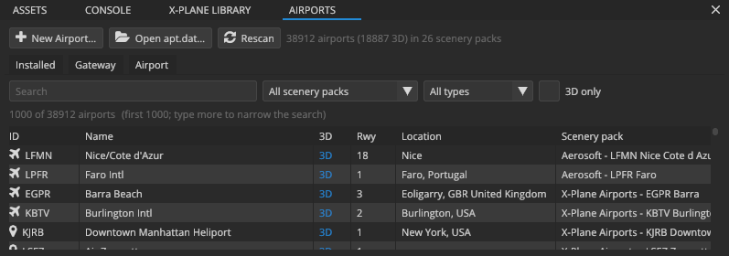

# Airports

Scenery Editor X reads and writes X-Plane 12 airport data, the `apt.dat` 12.00 format, losslessly: rows it doesn't edit are written back exactly as they were. You can open any airport in your install, pull one from the Scenery Gateway, or create a new one, and edit it in the viewport and the PROPERTIES panel.

## The AIRPORTS panel

The **AIRPORTS** panel has three tabs:

- **Installed:** every airport in your X-Plane install and custom packs.
- **Gateway:** the X-Plane Scenery Gateway.
- **Airport:** the open airport: its details, contents and problems.

Its toolbar has **New Airport…**, **Open apt.dat…** (an airport file from anywhere) and **Rescan** (index the install's `apt.dat` files again).

### Finding an airport

The **Installed** tab searches the airport index the editor builds from X-Plane's Global Airports and every pack in `Custom Scenery`. It reads only the airport headers, so the whole world indexes in about a second, and the index is cached between sessions.

- **Search** by code (ICAO, IATA, FAA or local), name, city or country. Several words narrow the search.
- **Scenery pack** limits the list to one pack (or **All scenery packs**).
- **Type** limits it to airports, seaplane bases or heliports.
- **3D only** shows airports with 3D scenery.

The list shows each airport's **ID**, **Name**, whether it's **3D**, its runway count (**Rwy**), **Location** and **Scenery pack**, with the matching count above it. Only the first 1000 matches are listed; type more to narrow it down.

Select an airport to see its codes, position, type and which `apt.dat` (and line) it comes from. Then:

- **Open** (or double-click) loads it into the scene;
- **Gateway** looks it up on the Scenery Gateway;
- **Website** opens its Gateway page in your browser.

> [!NOTE]
> X-Plane's **Global Airports** are read-only: they belong to X-Plane and are replaced by its updates. You can open and edit one, but saving asks for a scenery pack of your own (**Save As**). The same goes for any airport file the editor can't write.

## Opening an airport

When you open an airport, the editor:

1. reads it from its `apt.dat`;
2. builds its runways, pavement, painted lines, lights, signs, windsocks and the rest, textured and marked the way X-Plane 12 draws them (runway markings, pavement tiles and decals included);
3. loads the scenery pack's DSF art around the airport (objects, facades, forests, polygons, lines and roads) so you see the airport as X-Plane shows it;
4. frames the airport in the viewport.

Large packs take a few seconds; the objects keep appearing in the background as they load.

Only one airport is open at a time, unless it's part of a project (a project can hold several airports and shows the one you choose in **AIRPORTS › Airport**).

The **X-Plane** menu has the same commands: **Open Airport (apt.dat)…**, **Save Airport** (<kbd>Ctrl+S</kbd> when no project is open), **Save Airport As…** (<kbd>Ctrl+Shift+S</kbd>), **Frame Airport**, **Close Airport** and **Rescan Airports**.

> [!TIP]
> The DSF art of an airport you open from a pack is shown for reference. To edit that art too, open the pack's WorldEditor project (`earth.wed.xml`) as a project instead (**File › Open Project…**): its objects, facades, polygons and roads become project items you can edit, and its airport comes along.

## The Airport tab

**AIRPORTS › Airport** shows the open airport, with **Save**, **Save As…**, **Close** and **Reveal** (show the pack folder) at the top.

### AIRPORT

The airport's identity:

- **ID:** up to seven characters, unique across X-Plane: the ICAO code when there is one, or the code the Gateway assigned.
- **Name** and **Type** (airport, seaplane base or heliport).
- **Elevation** in feet above sea level. X-Plane 12 takes the elevation from its terrain; the value is kept for older versions.
- **Contents:** how many elements it has.

### METADATA

The airport's `1302` rows as key / value pairs: `city`, `country`, `state`, `region_code`, `icao_code`, `iata_code`, `faa_code`, `datum_lat`, `datum_lon`, `transition_alt` and the rest. Edit a value, remove a row (trash icon) or **Add** one.

### CONTENTS

The number of each kind of element, with a toggle to show or hide that kind in the viewport:

| Element | apt.dat rows |
|---|---|
| Runways, water runways, helipads | 100, 101, 102 |
| Pavement | 110 and its nodes |
| Lines and lights | 120 and its nodes (painted lines and light strings) |
| Boundary | 130 |
| Signs | 20 |
| Approach lights | 21 (VASI, PAPI, wigwags…) |
| Startup locations | 1300 / 15 |
| Windsocks, beacon | 19, 18 |
| Taxi routes and nodes | 1200 network (1201, 1202, 1204…) |
| Ground service | 1400 / 1401 truck parking and destinations |
| Jetways | 1500 |

Below are the **Frequencies** (ATIS, Unicom / CTAF, clearance, ground, tower, approach, departure), with **Add frequency**, and the **Traffic flows**.

### VALIDATION

What X-Plane would object to, checked as you edit: missing or malformed rows, unclosed shapes, values out of range. The header turns into *VALIDATION (PROBLEMS)* when there are any.

## Editing airport elements

Select an element in the viewport (<kbd>Q</kbd>, then click) and edit it in **PROPERTIES**:

| Element | What you can edit |
|---|---|
| **Runway** | Surface (and shoulder), edge lights; for each end: number, markings (visual, non-precision, precision, and their UK and EASA variants), approach lights (ALSF-I, ALSF-II, Calvert, SSALR, MALSR, ODALS, RAIL…), REIL |
| **Helipad** | Surface, edge lights |
| **Pavement** | Surface, layer (draw order), outline; node count |
| **Line or light string** | Painted line type, light string type; node count and rings |
| **Beacon** | Type |
| **Sign** | Size, and the text in X-Plane's sign syntax (for example `{@Y}A{@L}22{^r}`) |
| **Approach light** | Type |
| **Startup location** | Type, aircraft size (width code), operation type, airlines (space-separated ICAO airline codes) |
| **Ground service** | Truck type, an optional replacement vehicle (row 1402), and what a destination serves (`baggage_loader|fuel_jets|food|pushback…`) |
| **Jetway** | Style, size, custom objects |

To change shapes, use the **Nodes** tool (<kbd>V</kbd>) on pavement, lines, boundaries and runway ends: drag nodes and bezier handles, insert and delete nodes. See [Editing shapes and paths](node-editing.md). Move elements with the **Move** tool (<kbd>W</kbd>), and delete them with <kbd>Del</kbd>.

An edit rebuilds only the rows it changed, so even an airport with thousands of elements updates in milliseconds.

> [!NOTE]
> This alpha can't yet draw new pavement, lines or runways from scratch. A new airport starts with a runway, a windsock and a beacon (the *starter layout*); add more by importing a WorldEditor project or an `apt.dat`, or start from an existing airport.

## Creating an airport

There are two ways:

- **As a project** (recommended): **File › New Project…**, kind **Airport**. The project holds the airport and anything else the pack places, and exports the whole pack. The [tutorial](tutorial-first-airport.md) walks through it.
- **As a bare scenery pack**: **AIRPORTS › New Airport…** asks for the **Airport ID**, name, type, latitude and longitude of the datum, elevation, the folder to create the pack in (Custom Scenery by default) and the pack's folder name. It writes a pack with just `Earth nav data/apt.dat`.

To add an airport to an open project, use **File › New Airport in Project…** or **New airport** in the PROJECT panel.

## The Scenery Gateway

The [X-Plane Scenery Gateway](https://gateway.x-plane.com) is the community's shared airport database; X-Plane ships its approved airports as Global Airports. The **Gateway** tab browses it.

<!-- class: steps -->
1. Click **Download list** the first time (about 20 MB). The list is kept for a day; **Refresh list** fetches it again.
2. Search by airport code or name. **Has scenery** shows only airports with 3D submissions.
3. Select an airport to see its submissions: artist, upload date, status and comments. The recommended submission (the one X-Plane ships) is marked.
4. Click **Install recommended…**, or select a submission and click **Install selected…**.
5. Choose where to install it (**Install in**, Custom Scenery by default) and the pack's folder name. An existing pack with that name is kept; the download gets a suffix instead.
6. Leave **Add to the top** ticked to list the pack first in `scenery_packs.ini`, so X-Plane loads it with top priority.
7. Click **Install**. The editor downloads the submission, unpacks the scenery pack inside it and opens its airport.

A right-click on an airport in the **Installed** list also offers **Show on the Gateway website** and **Look up on the Gateway**.

Downloads are cached in `%LOCALAPPDATA%\SceneryEditorX\cache\gateway`, so installing the same submission again doesn't download it twice.

> [!IMPORTANT]
> Uploading to the Gateway isn't built in yet. To submit an airport, export the pack with an `earth.wed.xml` (see [Exporting a scenery pack](import-export.md#exporting-a-scenery-pack)), open it in WorldEditor, and use WorldEditor's Gateway upload.

## Saving

**Save** writes the pack's `Earth nav data/apt.dat` atomically: the new file replaces the old one only once it's completely written, so a crash can't leave half an airport behind. **Save As…** writes the airport into another scenery pack folder.

When the airport is part of a project, saving the project (<kbd>Ctrl+S</kbd>) saves the airport with it, and exporting the project writes its `apt.dat`.
