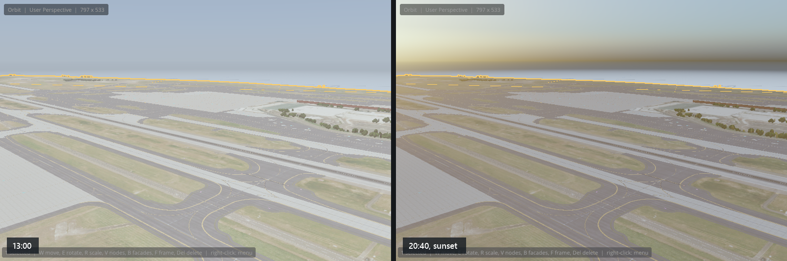

# Time, weather and the X-Plane 12 look

The viewport doesn't just show your scenery: it lights it the way X-Plane 12 does, for any date, time and place. Textures, normal maps, lights and shadows look as they will in the sim, so you can judge a scene without exporting and loading X-Plane. This chapter explains what the renderer emulates, how to set the time and weather, and how to tune or compare the result.

## What the viewport emulates

The renderer follows X-Plane 12's frame step by step and is calibrated against X-Plane 12.4.4:

- **Physically based materials** from X-Plane's own data: albedo, normal and gloss maps, metalness, lit textures, and X-Plane's BRDF table.
- **The sun and moon** at their true positions for the date, time and place, with the moon's phase.
- **Photometric lighting:** the sun, sky and lights in real units, with an **exposure** like a camera's, metered automatically as X-Plane does.
- **The atmosphere:** the sky's color, haze near the ground, and **aerial perspective** (distant scenery fading into the air).
- **Environment probes:** reflections and ambient light taken from the sky and surroundings.
- **Sun shadows** in cascades, and **cloud shadows** moving over the ground.
- **Ambient occlusion** with the same technique as X-Plane 12 (FidelityFX CACAO), contact darkening where objects meet the ground.
- **Exposure fusion**, **bloom** and the **AgX** tone curve X-Plane 12.2 and later use, and **FXAA**.

> [!NOTE]
> The X-Plane 12 emulation is being built in stages. In this build, weather changes the light (sky condition, visibility, haze and cloud shadows), but **wet surfaces, puddles, snow on the ground, volumetric clouds, water, screen-space reflections, terrain and photometric night-light tiles** aren't drawn yet. They're listed, greyed out, in the RENDERER panel until they arrive.

## Date, time and place

Open the **ENVIRONMENT** panel.

### PRESETS

One click sets the weather: **Clear**, **Hazy**, **Foggy**, **Overcast**, **Rain** or **Snow**. A second row offers the weather of the editor's X-Plane 12 comparison scenarios.

### DATE & TIME

- **Date** (year, month, day) and **Local time**: these drive the sun and moon, X-Plane's `sim/time` datarefs, and when lights come on.
- **UTC offset** of the local time.
- **Place:** tick **Use the airport's location** to take the latitude, longitude and elevation from the open airport's reference point, or type a **Latitude**, **Longitude** and **Elevation**.

> [!TIP]
> The UTC offset isn't taken from the place: it starts at 0, which makes *Local time* the time in London. For an airport elsewhere, set the offset to its local time zone (for example −7 for Portland in summer, +1 for Paris in winter), or the sun will be where it is at that hour in UTC. The **UTC** read-out under SUN & MOON shows what the editor is using.

### SUN & MOON

Read-outs of where the **Sun** and **Moon** are, the **Moon phase**, the **UTC** time, and **Daylight**.

## Weather

The **WEATHER** section follows X-Plane's weather model:

- **Visibility** at the surface.
- **Cloud layers:** for each, the coverage in eighths, the **base and tops**, and the **type** (cirrus, stratus, cumulus, cumulonimbus).
- **Rain**, which falls as snow below 0 °C, and the **Temperature**.
- **Wind from** and **Wind speed** (they also drive animated windsocks), **Waves** and **Waves from**.

The **SKY CONDITION** section shows how the weather changes the light: the multipliers it applies to ambient light, direct sunlight and tone.

### Surface

The **SURFACE** section sets how wet, snowy or icy the ground is:

- **Runway state:** X-Plane's 16 runway friction states: dry; wet, puddly, snowy, icy, and snowy and icy, each light, medium or heavy.
- **Snow cover.**
- **Over time: Rain soaks and the sun dries.** Instead of following the runway state, wetness builds while it rains and dries out afterwards, as in the sim.
- **Result:** how wet, puddled, snowy and icy the surface is now, in percent.

### Season

X-Plane 12 changes vegetation and some textures with the seasons. The **SEASON** section picks **Spring**, **Summer**, **Fall** or **Winter**, or works it out from the date and latitude, and how far the season has moved **toward the next** (automatically, or by hand). **Result** shows the season the scenery is drawn in.

## Lights at night

Lit textures (`_LIT`) and lights switch on at dusk, as they do in X-Plane. To check night lighting in daylight, tick **Force lights on** in the X-PLANE LIBRARY's **Simulation** tab (see [The X-Plane library](library.md#simulation)).

X-Plane 12's photometric light *spill* (lights brightening the pavement and walls around them) belongs to the tiled-lights step of the emulation, which isn't in this build yet.

## Exposure
Like X-Plane, the editor exposes the scene like a camera. The **EXPOSURE** section of the RENDERER panel sets:

- **Mode:** **Auto (metered)**, as X-Plane does it, or **Manual**, at the **Manual EV100** you set (or from the aperture, shutter and ISO in the CAMERA panel).
- **Compensation** on top of the automatic exposure (positive brightens).
- **Adaptation:** how quickly the exposure follows a change in brightness, or jump straight to the metered value.
- **Bloom** strength, and the **exposure fusion** settings that lift dark interiors and tame bright skies.

Its read-outs show the exposure in use, what was metered, and the target.

## Renderer quality and features
The **RENDERER** panel shows frame timings and GPU memory, and controls what the renderer draws.

### QUALITY

The same quality levels as X-Plane 12's graphics settings: **Shadows**, **Ambient occlusion**, **Clouds**, **FSR** and **Draw distance**, plus **FXAA**. **X-Plane defaults** sets X-Plane 12's own defaults. Read-outs show what the levels mean (shadow cascades, distance and resolution; the ambient occlusion quality).

On a slower GPU, lower **Shadows** and **Ambient occlusion** first.

### XP12 EMULATION

A switch for each step of the X-Plane 12 frame, so you can see what each contributes or turn off the expensive ones:

| Switch | What it does |
|---|---|
| Atmosphere | The sky, and the light tables the atmosphere uses |
| Aerial perspective | Haze between the camera and what it sees |
| Environment probes | Reflections and ambient light from the surroundings |
| Sun shadows | Cascaded shadow maps from the sun |
| Cloud shadows | Shadows of the cloud layers on the ground |
| Ambient occlusion | Contact darkening (CACAO) |
| Screen-space shadows | Fine contact shadows (X-Plane 12.4 has none; off by default) |
| Auto exposure | Metering the exposure |
| Exposure fusion | Local tone mapping |
| Bloom | Glow around bright lights |
| Tone mapping | The exposure and output curve; off shows the frame as rendered |
| FXAA | Anti-aliasing |

Switches for passes not in this build yet are greyed out. **Tone curve** picks **AgX** (X-Plane 12.2 and later), an ACES fit or Reinhard. **All off** and **Defaults** set every switch at once.

Every switch also has a command-line option, `--no-<name>` or `--with-<name>`, listed in [Command-line options](command-line.md#renderer-and-environment).

### Other sections

- **GPU SCENE:** scenery is culled, given its level of detail and drawn on the GPU (**GPU-driven**), with **Cull below** (objects smaller than this many pixels aren't drawn), **LOD scale**, and frustum and occlusion culling.
- **ATMOSPHERE, SHADOWS, AMBIENT OCCLUSION:** fine controls, named after the X-Plane settings they match.
- **DEBUG VIEW:** shows one ingredient of the frame instead of the result, for tracking down why something looks wrong: **Albedo**, **Roughness**, **Metalness**, **Normals**, **Emissive**, **Ambient occlusion**, **Shadow cascades**, **Cloud shadow**, **Exposure** (EV in false colour), **Luminance** and **Depth**, plus views for passes still to come.
- **GPU TIMINGS** and **GPU MEMORY:** where the frame's time and the GPU's memory go.

## Comparing with an X-Plane screenshot
To check a scene against the sim:

<!-- class: steps -->
1. In X-Plane 12, take a screenshot of the scene from a known spot, and note the date, time and weather.
2. In the editor, set the same date, time, place and weather in ENVIRONMENT, and frame the same view.
3. In the viewport toolbar, open the **Reference image** menu and **Load reference image…** (a PNG).
4. Choose how to compare: **Split** (half of each), **Difference** (bright where they differ; raise the **Difference gain** to see small differences), or **Flicker** (switching once a second).
5. **Clear** removes the image.

For exact, repeatable comparisons, the editor reads *parity scenario* files that describe a view, a time and the weather; see `--env-scenario` in [Command-line options](command-line.md#renderer-and-environment).
