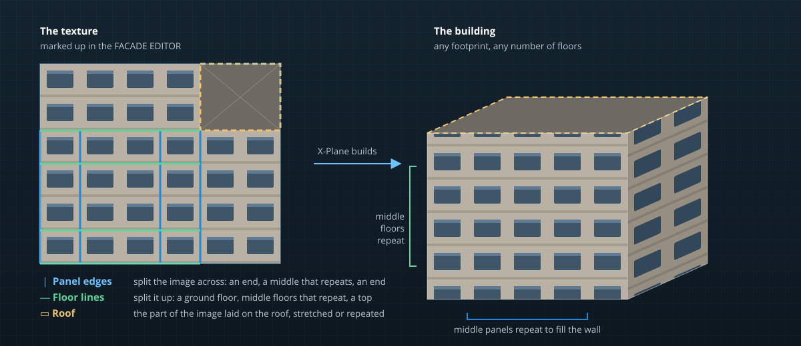

# Making your own facades

The **FACADE EDITOR** makes new facade (`.fac`) files without a text editor: a type 1 building from a texture you mark up, or a type 2 sidewalk, curb or low wall from a cross-section you draw. It can also open a copy of any library facade for you to adapt. Facades you make are saved in your project's folder and work in X-Plane like any other.

## Starting a facade

Open the panel from the panel strip, or use the **Facade** menu (also in the facade tool's facade box under **New facade**):

| Command | Panel button | Makes |
|---|---|---|
| **New Building Facade…** | **New building** | A type 1 facade from a texture: you mark its panels and floors on the image. |
| **New Sidewalk / Curb Facade** | **New sidewalk / curb** | A type 2 ground facade from a cross-section: 3D sidewalks, curbs, planters, low walls. |
| **Edit Facade** | **Edit selected** | The selected (or armed) facade. The project's own facades open in place; a library or other pack's facade opens as a copy, with its textures (and a type 2's objects) copied into the project. |
| | **Open** | A facade from the project's `facades` folder. |

A project must be open: facades are saved as `facades/<name>.fac` in the project folder, with their textures beside them.

## The editor's toolbar

| Control | What it does |
|---|---|
| **Name** | The file name. The facade is saved as `facades/<name>.fac`. |
| **Save** | Writes the `.fac`, and redraws every facade in the scene that uses it. |
| **Undo** / **Redo** | The editor's own history: <kbd>Ctrl+Z</kbd> / <kbd>Ctrl+Y</kbd> undo facade edits while the panel has focus, separately from the project's history. |
| **Revert** | Goes back to the saved file. |
| **Place preview** | Saves, then drops a footprint built with the facade where the viewport is looking (one undo step). Afterwards the button becomes **Show preview**, which selects and frames it. |
| **Live** | Saves and redraws shortly after every change, so the preview (and every footprint using the facade) updates as you edit. |
| **Draw with it** | Arms the facade in the Facade tool (<kbd>B</kbd>). |
| **Inspect** | Opens the facade in the FACADES inspector. |

> [!TIP]
> Turn **Live** on and place a preview first. Then every change you make in the panel shows on the building in the viewport, lit the way X-Plane lights it, a third of a second later.

## A building from a texture (type 1)

A type 1 facade wraps rectangles of one texture around the footprint. You tell it which parts of the image are wall panels (repeated across a wall), which are floors (stacked up the wall), and which part is the roof.

<!-- class: steps -->
1. Click **New building** and choose a texture (`.png`, `.dds`, `.jpg`, `.tga` or `.bmp`). A texture outside the project is copied into its `facades` folder.
2. Under **TEXTURES**, the image is shown with the panel edges (vertical lines) and floor lines (horizontal lines) of the selected wall type. Use **Panels across** and **Floors up** to start from an even grid, then drag edges to the real panel and floor boundaries. Edges snap to whole texture pixels (hold <kbd>Alt</kbd> to place one freely); <kbd>Ctrl</kbd> + wheel zooms the image. Split a panel in two or remove an edge with the buttons beside it.
3. Set the **Texture size**: how many meters the whole texture covers across and up (`SCALE`). **Square pixels** keeps the proportions of the image.
4. Add more **WALL TYPES** if the building needs them (narrow walls, gable ends, a front with a door). For each:
   - **Widths:** walls this wide (in meters) can get this type;
   - **Headings:** walls facing these degrees from the front wall, clockwise, can get it (`270–90` is the front half; equal values mean any heading);
   - X-Plane takes the *first* wall type whose rules accept a wall, so order matters: move the specific types up.
5. Set the **ROOF**: **No roof**, **Stretched** (a rectangle of the texture covers the whole roof) or **Repeated** (it covers so many meters and repeats, `ROOF_SCALE`). **Roof slope** leans the top floor in, for a hipped look.
6. Under **BUILDING**, set the **Floors** X-Plane may build (minimum and maximum), and the options:
   - **Graded:** flat on its first wall instead of draped on the terrain;
   - **Two-sided** walls; **Doubled:** walls built inside and out (fences);
   - **Drawn to:** the distance it stays visible;
   - **Hard surfaces:** what aircraft and vehicles feel on the walls and roof (concrete, asphalt, metal…), or none.
7. **Save**, then **Place preview** or **Draw with it**.

**Snap all to pixels** rounds every edge of a wall type to whole pixels, which avoids the thin seams a fractional edge can leave in X-Plane.

## A sidewalk or curb from a cross-section (type 2)

A type 2 ground facade sweeps a cross-section (a *profile*) along the footprint. This is how X-Plane 12's 3D sidewalks and curbs are made.

<!-- class: steps -->
1. Click **New sidewalk / curb**.
2. Under **CROSS-SECTION**, start from a preset, or draw your own profile point by point:

   | Preset | Shape |
   |---|---|
   | Sidewalk curb 15 cm | A 15 cm curb with a rounded top edge |
   | Low curb 10 cm | A 10 cm curb |
   | Flush edge 5 cm | A low edge flush with the pavement |
   | Planter wall 45 cm | A 45 cm wall, 22 cm thick |
   | Retaining wall 1 m | A 1 m wall, 30 cm thick |

   Each point is an offset across and a height; add a point after any other, and points snap to texture pixels.
3. Choose **Closed (sidewalk)** for a sidewalk or planter around an area (its top becomes the walking surface), or leave it open for a curb or wall along a line.
4. Under **TEXTURES**, choose the textures, how often the walking surface repeats (**Surface repeat**), its **Hard surface**, and the **Strip length**: how many meters of curb the texture strip covers before it repeats.
5. Under **SEGMENTS**, set the **Lengths** of the segments the facade is built from. **Spell up to** fills every multiple of the shortest segment up to that length, and longer walls repeat them. **Curve pieces** sets how long the pieces of the curved variants are (0.5 to 0.8 m follows the 3D sidewalk recipe).
6. **Save**, then draw it with the Facade tool, or use **Add around…** on a building to put it around the building's footprint (see [Drawing facades](facades.md#rebuilding-the-footprint)).

The cross-section's settings are kept beside the facade as `<name>.fac.json`, so you can reopen and change the profile later. Only the `.fac` is needed in X-Plane.

## Adapting a library facade

**Edit selected** on a facade from the X-Plane library (or another pack) copies it into your project:

- its `.fac`, renamed if a facade of that name is already there;
- its textures, including the `.dds` or `.png` twin X-Plane would load;
- for type 2, the objects its segments attach (references to `lib/` objects stay as library references).

A type 1 copy can be edited like a building you made. A type 2 copy lets you change its textures, roof texture repeat, hard surfaces, and its wall types' names and rules; its segments are shown read-only. Rows the editor doesn't model are written back exactly as they were.

> [!IMPORTANT]
> Library facades are other people's work. Check the library's license before you ship an adapted copy in a pack, and credit its author.

## How the files are written

The editor writes `.fac` files the way a careful author would by hand: values are printed so that X-Plane reads back exactly the numbers you set, and a facade that is read and saved again describes exactly the same facade. The editor's test suite checks that round trip against every default X-Plane 12 scenery facade.
