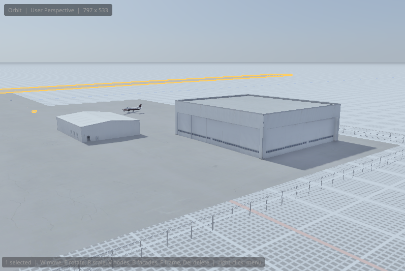

# Drawing facades

A **facade** (`.fac`) is a building, fence, wall, sidewalk or curb that X-Plane generates along a footprint: you draw the outline, and X-Plane fills each side with walls taken from the facade. One facade file can make a whole street of different buildings. This chapter covers drawing facades and editing the ones you've placed; [Making your own facades](facade-editor.md) covers creating new `.fac` files.

## How facades work

A few X-Plane ideas explain everything the facade tools do:

- **Type 1 and type 2.** Type 1 facades are built from rectangles of one texture: simple, light, good for distant buildings. Type 2 facades are built from small 3D meshes (*segments*) laid along each wall, with real depth: hangars, terminals, 3D sidewalks and curbs.
- **Families.** The editor sorts facades into **buildings** (closed footprints with a roof), **ground** facades (sidewalks and curbs, with no height), **enclosures** (fences and walls around an area) and **lines** (an open run of walls).
- **Walls and wall types.** Each side of the footprint is a **wall**. A facade offers one or more **wall types** (for example *front*, *side*, *door*), each with its own look.
- **Wall rules.** Unless told otherwise, X-Plane picks each wall's type by the facade's rules: how long the wall is and which way it faces relative to the **front wall** (wall 1, the first one you draw).
- **Heights.** Type 1 facades take any height. Type 2 facades have **floors** of fixed heights, so they snap to the nearest floor's roof.
- **Direction.** Walls face outward when the footprint runs counter-clockwise (seen from above). Drawn the other way, a building's walls face inward; the editor warns you.

## The Facade tool

Press <kbd>B</kbd> for the **Facade** tool. A facade must be **armed** before you can draw: pick it from the facade box on the viewport toolbar (recent facades, the library, the project's own facades, or **New facade**), double-click a `.fac` in the X-PLANE LIBRARY, or choose one under <kbd>Space</kbd> › **Facades**.

The viewport toolbar then shows:

- the armed facade;
- the four **drawing modes**;
- the **height** new facades are built at (type 2 facades list their floor heights);
- for facades with several wall types, the **wall type** new facades get on every wall (the first leaves the choice to X-Plane's rules);
- in Circle mode, the **circle wall** length: meters per wall of a circle (4 m by default; 0.5 to 0.8 m suits curbs).

A hint at the bottom of the viewport says what the next click does.

### Drawing modes

| Mode | Key | How to draw | Good for |
|---|---|---|---|
| **Polygon** | <kbd>1</kbd> | Click each corner. Click the first corner again, double-click, or press <kbd>Enter</kbd> to close. | Any building outline |
| **Rectangle** | <kbd>2</kbd> | Click one end of the front wall, then its other end, then click to set the depth. | Buildings, hangars, yards |
| **Circle** | <kbd>3</kbd> | Click the center, then click to set the radius. | Tanks, round buildings, roundabout curbs |
| **Line** | <kbd>4</kbd> | Click to add each post; double-click, <kbd>Enter</kbd> or right-click to finish. | Fences, walls, hangars built along their length, doors |

While drawing: hold <kbd>Shift</kbd> to keep walls at 45° steps (in Rectangle mode, to make a square), press <kbd>Backspace</kbd> to take back the last corner, and <kbd>Esc</kbd> to cancel. <kbd>Q</kbd> goes back to the Select tool.

Each facade you draw is one undo step and becomes a project item, written to the DSF when you export.

> [!TIP]
> The quad menu on empty ground (right-click) has the four drawing modes and **Place *facade* Here**, which drops the armed facade with a default footprint right where you clicked.

## Editing a facade

Select a placed facade (with any tool). The **FACADE** section of PROPERTIES shows:

- **Facade:** the `.fac` it uses. Pick another from the same library folder; walls keep their types by name.
- **Kind:** type 1 or 2, its family, and whether it's a skyscraper.
- **Height:** pick one of the facade's heights (type 2), or type any height (type 1).
- **Pick walls:** **on**, every wall is built with the type set here (and the DSF stores them); **off**, X-Plane picks each wall by its rules.
- **Footprint:** the number of walls (and curved walls), the perimeter, and the area; a warning if it runs clockwise.
- A **wall table**: each wall's number (**F** marks the front), length, type, and **fit**. The fit shows how much a type 2 wall's segments stretch to fill it (100% is their own size), or a warning when the wall type's rules don't accept this wall (X-Plane builds it anyway when walls are picked).

Several selected facades can be edited at once: the change applies to all of them.

### Picking walls

With the Facade tool active, **click a wall** of a selected facade to pick it (<kbd>Shift</kbd> adds more). Picked walls are highlighted, and the wall-type menus apply to them instead of to every wall. Turn on **Facade › Wall Labels** to see each wall's number, type and length in the viewport.

Right-click a facade for its quad menu: **Wall Type**, **Height**, **Replace With**, **Pick Walls**, **Make Picked Wall the Front**, **Draw With This Facade**, **Inspect Facade** and **Edit Facade**.

### Rebuilding the footprint

| Command | What it does |
|---|---|
| **Subdivide curved walls** | Cuts curved walls into straight pieces of the length you set beside the button (0.65 m by default). This is X-Plane's recipe for 3D sidewalks and curbs that follow a curve: X-Plane stretches gaps toward curve vertices, so short straight pieces look right. |
| **Square corners** | Turns walls within 15° of the footprint's main axes onto them, for right-angled corners. |
| **Reverse** | Reverses the footprint: walls face the other way, and a fence runs the other way. |
| **Make front** | Makes the picked wall the front (wall 1). X-Plane measures wall headings and lays the roof from the front. |
| **Add around…** | Creates a new facade around this one's footprint, at the offset you set: a 3D sidewalk or curb around a building (the `lib/airport/ground/sidewalk_15cm` sidewalks are listed first), or a fence around a yard. |

These are also in the **Facade** menu and the quad menu, and every one is an undo step. The Nodes tool (<kbd>V</kbd>) edits a facade's footprint like any other shape (see [Editing shapes and paths](node-editing.md)); facade walls keep their types as you move nodes.

## The FACADES inspector

**Inspect** (in the details of a library facade, PROPERTIES, or the quad menu) opens the facade in the **FACADES** panel, which shows how it's built:

- **FACADE:** the file and the objects it attaches;
- **FLOORS:** each floor's height and roof;
- **WALLS:** each wall type's name, its rules (the widths and headings it accepts), its texture, and its panels or floors;
- **SPELLING PREVIEW:** how the segments of the selected wall's spellings line up;
- **SEGMENTS:** the type 2 meshes the walls are made of.

By default the inspector follows the selected facade (or the one armed in the facade tool). Turn that off to keep the last facade you inspected. Its buttons:

- **Reload** reads facades and the project's other art again after you change them on disk;
- **Draw with it** arms the facade in the Facade tool;
- **Edit** opens it in the FACADE EDITOR: the project's own facades in place, any other facade as a copy in the project's `facades` folder, with its textures and objects copied along.

## How the editor matches X-Plane

The editor builds facades with the same rules X-Plane and WorldEditor use: the floor whose roof is closest to the height you set, each wall's type by its width and heading rules when walls aren't picked, WorldEditor's choice of spelling for each wall's length, curved walls bent along their bezier, and attached objects facing the way X-Plane places them. What you see in the viewport is what X-Plane will build.
