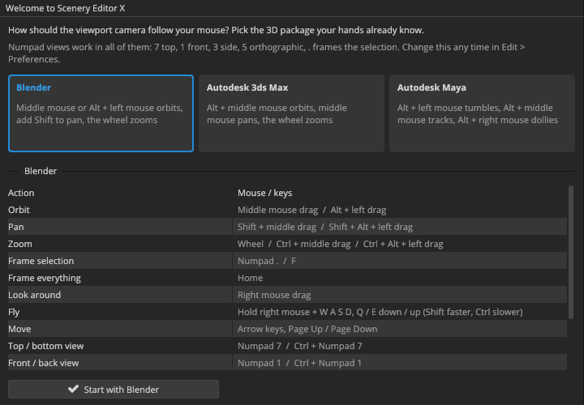
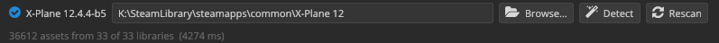

# First launch

The first time Scenery Editor X starts it asks one question, how you like to move a 3D camera, and then looks for X-Plane on its own. This chapter covers both, and what the editor does in the background while you get your bearings.

## What happens at startup

When you start the editor it:

1. **Checks Vulkan.** If the graphics driver can't run Vulkan 1.3, a message explains what's missing before anything else opens (see [Checking Vulkan](installing.md#checking-vulkan)).
2. **Sets up its folders.** Settings go in `%APPDATA%\SceneryEditorX`, caches and recovery data in `%LOCALAPPDATA%\SceneryEditorX`. If an older test build kept files somewhere else, they are moved once, never overwriting anything. [Where Scenery Editor X keeps files](file-locations.md) has the full list.
3. **Finds X-Plane** and starts indexing its libraries and airports in the background.
4. **Opens the workspace** with the last panel layout you used.

The first start takes longer than the ones after it: the editor compiles its shaders and builds its airport index, and keeps both in its cache for next time.

## Choosing a navigation keymap

The **Welcome to Scenery Editor X** window asks how the viewport camera should follow your mouse. Pick the 3D package you already know:

| Keymap | Orbit | Pan | Zoom |
|---|---|---|---|
| **Blender** | Middle mouse, or <kbd>Alt</kbd> + left mouse | <kbd>Shift</kbd> + middle mouse | Wheel, or <kbd>Ctrl</kbd> + middle mouse |
| **3ds Max** | <kbd>Alt</kbd> + middle mouse | Middle mouse | Wheel, or <kbd>Ctrl+Alt</kbd> + middle mouse |
| **Maya** | <kbd>Alt</kbd> + left mouse (tumble) | <kbd>Alt</kbd> + middle mouse, or middle mouse (track) | <kbd>Alt</kbd> + right mouse (dolly), or wheel |

Click a card to see its full list of bindings, then click **Start with *keymap*** (or double-click the card, or press <kbd>Enter</kbd>).

Whichever you choose, some controls are the same everywhere: the numeric keypad views (<kbd>Numpad 7</kbd> top, <kbd>Numpad 1</kbd> front, <kbd>Numpad 3</kbd> side, <kbd>Numpad 5</kbd> orthographic, <kbd>Numpad .</kbd> frames the selection), and holding the right mouse button to look around and fly with <kbd>W</kbd> <kbd>A</kbd> <kbd>S</kbd> <kbd>D</kbd>.

> [!TIP]
> Not a user of any of these? Choose **Blender**: everything works with a mouse wheel, the middle button and <kbd>Alt</kbd>, and [Navigating the viewport](viewport-navigation.md) explains it step by step.

You can change your mind at any time in **Edit › Preferences…** (the **Navigation** tab), or bring the welcome window back with **Help › Choose a Navigation Keymap…**. The preferences also let you invert the orbit directions, choose the orbit and zoom speeds, and turn off the smooth gliding between views.

## Finding X-Plane

Scenery Editor X needs to know where X-Plane is installed: it reads the library assets, airports and lighting data from there. It looks, in order of trust, in:

- the install lists X-Plane itself keeps (`x-plane_install_12.txt` and `x-plane_install_11.txt` in your local application data),
- your Steam libraries (X-Plane 12 and X-Plane 11 bought on Steam),
- the uninstall entries in the Windows registry,
- the usual folders on your local drives.

When it finds more than one install, it prefers a complete one, then the newest major version, then the one you ran most recently.

To see what it found, open the **X-PLANE LIBRARY** panel. The bar at the top shows a green check and the X-Plane version when a folder is set, or what's wrong with it.

To change it:

- **Detect** lists every X-Plane 11 and 12 install it can find, with where it found each one. Click one to use it.
- **Browse…** picks the folder by hand. Choose the X-Plane folder itself: the one with `Custom Scenery`, `Resources` and the X-Plane application in it.
- Or type the path into the field and press <kbd>Enter</kbd>.
- **X-Plane › Set X-Plane 12 Folder…** in the menu bar does the same as Browse.

Changing the folder rescans the libraries straight away.

> [!NOTE]
> Scenery Editor X never writes into X-Plane's own folders (`Resources`, `Global Scenery` and the default libraries). It only writes into scenery packs you create or choose, and into `Custom Scenery/scenery_packs.ini` when you ask it to list a pack there.

## While it indexes

Two scans run in the background after X-Plane is found:

- **Libraries.** Every `library.txt` in `Custom Scenery`, the default libraries and any folders you track. This takes a few seconds; the X-PLANE LIBRARY panel shows *Scanning libraries…* until it's done.
- **Airports.** Every `apt.dat`: X-Plane's Global Airports and each custom pack. Only the headers are read, so the whole world indexes in about a second, and the index is cached between sessions.

You can work while they run. Airports and library assets appear in their panels as soon as the scans finish.

## Your first look around

The workspace is modeled on Adobe Substance 3D Painter: dark, flat panels around a large viewport.

- The **menu bar** across the top holds every command.
- The **tool strip** on the left holds the editing tools: select, move, rotate, scale, nodes and facade.
- The **viewport** in the middle shows the scene.
- The **panel strip** on the right opens and closes panels; the panels themselves dock around the viewport.
- The **status bar** at the bottom shows the latest warning or error (click it to open the console), objects loading in the background, the frame time and GPU memory.

[A tour of the interface](interface.md) goes through each of these. If you rearrange the panels and want the original layout back, use **Window › Reset Layout**.

## Next steps

- To learn by doing, follow [Tutorial: your first airport](tutorial-first-airport.md).
- To open an airport that already exists, see [Airports](airports.md).
- To open a WorldEditor project, see [Importing and exporting](import-export.md).
