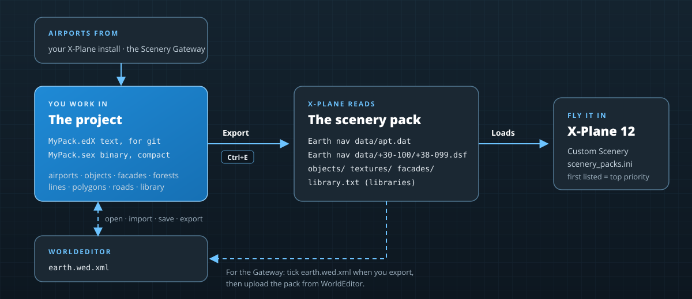

# Importing and exporting

A project is where you work; X-Plane reads `apt.dat`, DSF tiles and art files; WorldEditor reads `earth.wed.xml`. This chapter covers moving scenery between them: exporting a pack for X-Plane, round trips with WorldEditor, and importing airports, libraries and objects.

## Exporting a scenery pack
**File › Export Scenery Pack…** (<kbd>Ctrl+E</kbd>) writes the open project as an X-Plane 12 scenery pack.

### Where

The folder defaults to the project's own folder, which is already laid out as a pack. The line under it tells you what X-Plane will make of the destination:

- *The project's own folder, in Custom Scenery: X-Plane loads it from here.*
- *A pack in Custom Scenery.*
- *Outside Custom Scenery: move the folder there to fly it.*

**Browse…** picks another folder, for example to export a clean copy for release. The editor refuses to write into X-Plane's own folders.

### What

| Option | Writes |
|---|---|
| **Airports** | `Earth nav data/apt.dat` with every airport in the project (hidden airports are left out). |
| **Overlay placements** | The DSF tiles under `Earth nav data/`: one per 1°×1° tile the project places anything in, with its objects, facades, forests, lines, polygons, strings and roads. |
| **Copy the pack's own objects and textures** | When exporting somewhere other than the project folder: the art the project places from its own folder, with the textures it names (`.png` and `.dds` twins included). Library art stays in its library. |
| **library.txt** | For projects that publish a library: the `library.txt` from the PROJECT panel's LIBRARY section. |
| **earth.wed.xml** | A WorldEditor project of the pack, so it can be opened in WorldEditor (for example to upload it to the Gateway). |
| **Include hidden items** | Exports hidden project items too. Off by default: hidden items stay in the project only. |
| **Remove DSF tiles the project no longer places anything in** | Deletes tiles left over from an earlier export, so moved scenery doesn't stay behind in its old tile. |
| **List the pack in scenery_packs.ini** | Adds the pack to the top of `Custom Scenery/scenery_packs.ini` (highest priority). Only for packs inside Custom Scenery. |

Under the options, the validation result: *No problems found*, or how many problems X-Plane may reject (open the list to read them). You can export anyway; X-Plane may then refuse part of the pack.

### Export

Click **Export**. The dialog reports how many airports, DSF tiles, objects and polygons it wrote, how many art files it copied and how many files it wrote in all, and any stale tiles it removed. Warnings (an art file it couldn't find, a pack it couldn't list) are listed below. **Show Folder** opens the pack in Explorer.

**File › Export Again** (<kbd>Ctrl+Shift+E</kbd>) repeats the last export with the same settings, without the dialog: handy while you go back and forth with X-Plane.

### How the DSF is written

The DSF files follow WorldEditor's layout, so X-Plane, WorldEditor and DSFTool all read them:

- one file per tile, named like `+38-099.dsf`, in `Earth nav data/+30-100/`;
- a header naming the pack's airports, so X-Plane's airport exclusions and filters apply to them;
- coordinates stored with the precision X-Plane expects, and an MD5 checksum at the end.

## WorldEditor round trips

### Opening a WorldEditor project

There are two ways to bring an `earth.wed.xml` in:

- **File › Open Project…** opens it directly. Saving writes `earth.wed.xml` back in WorldEditor's format, so the pack stays a WorldEditor project.
- **File › Import › WorldEditor Project (earth.wed.xml)…** imports it as a new, unsaved Scenery Editor X project. Save it (as `.edX` beside the WorldEditor file, by default) to keep working in the editor's own format.

Everything WorldEditor stores is kept: airports, groups, objects, polygons, orthophotos, lines, strings, forests, facades, exclusion zones, and roads and their junctions. WorldEditor objects the editor doesn't model are kept verbatim, so they survive a round trip. Anything that couldn't be read is reported in the CONSOLE under *WED import*.

### Exporting for WorldEditor

- **File › Export › WorldEditor Project (earth.wed.xml)…** writes the project as a WorldEditor project anywhere you choose.
- Or tick **earth.wed.xml** when exporting a scenery pack.

> [!TIP]
> To submit an airport to the Scenery Gateway, export the pack with `earth.wed.xml`, open it in WorldEditor, run WorldEditor's validation and upload from there.

## Airports

- **File › Import › Airports (apt.dat)…** adds the airports of an `apt.dat` file to the open project (the PROJECT panel's **From apt.dat** does the same).
- **File › Export › Airports (apt.dat)…** writes the project's airports to an `apt.dat` file of your choice.
- An airport opened on its own (not in a project) saves to its pack's `apt.dat` directly: see [Airports](airports.md#saving).

## Libraries

- **File › Import › Library (library.txt)…** reads a `library.txt` into the project's LIBRARY section, to edit its exports.
- **File › Export › Library (library.txt)…** writes it out.

## Objects

**X-Plane › Import Object (.obj)…** places one or more X-Plane `.obj` files from anywhere on disk straight into the scene, for checking an object you're building: its geometry, textures, animation and lights load like any library object. To use an object in a pack, put it in the project folder (or a library) and place it from there, so the pack can find it when it's exported.

## Binary copies

**File › Export › Binary Copy (.sex)…** writes a `.sex` copy of the project without switching to it, for example to hand a compact copy to someone else. See [Project file formats](file-formats.md).
