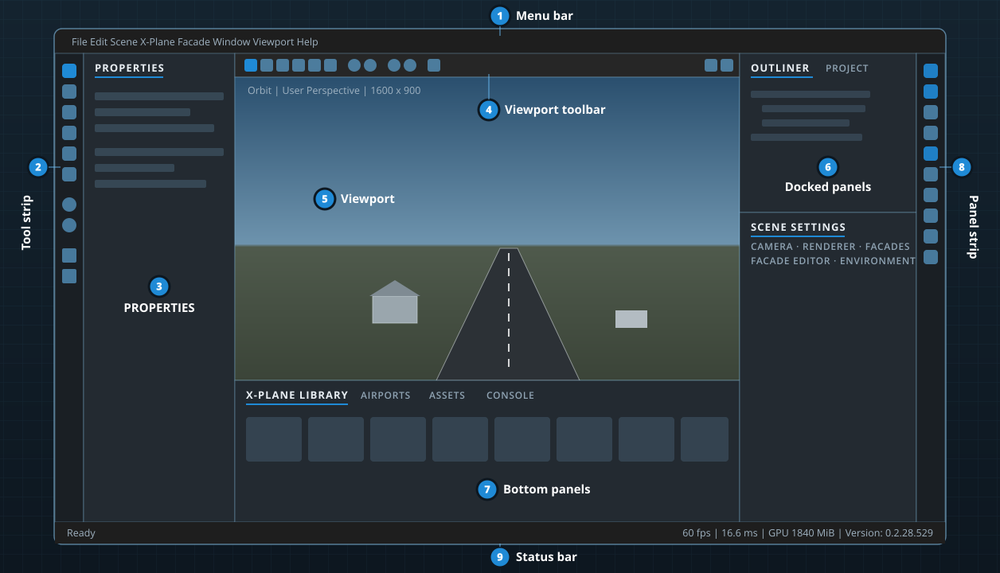

# A tour of the interface

The workspace is one window: a large 3D viewport surrounded by panels you can rearrange, with a menu bar on top, tool strips on both sides and a status bar at the bottom. This chapter names every part so the rest of the manual can refer to it.

## The menu bar

Every command lives in one of eight menus. [Menu reference](menus.md) lists every item.

| Menu | What's in it |
|---|---|
| **File** | New, open, save and close projects; import and export; recent projects. |
| **Edit** | Undo and redo, delete, duplicate, hide and lock, the editing tools, and **Preferences…** |
| **Scene** | Adding an empty entity to the scene. |
| **X-Plane** | Importing an `.obj`, opening and saving airports, the library browser, the X-Plane folder and library rescans. |
| **Facade** | Making facades, drawing them, and editing the selected ones. |
| **Window** | **New Viewport**, showing and hiding every panel, **Reset Layout**. |
| **Viewport** | Orbit or fly navigation, perspective or orthographic, view presets, framing, the navigation keymap. |
| **Help** | About, the navigation keymap chooser, and the controls and shortcuts list. |

You rarely need to travel to the menu bar: the same menus open at the mouse when you hold <kbd>Space</kbd> over the viewport (the [hotbox](selecting-and-editing.md#the-hotbox)).

## The tool strip

The narrow strip down the left edge holds, from the top:

1. **The editing tools:** Select <kbd>Q</kbd>, Move <kbd>W</kbd>, Rotate <kbd>E</kbd>, Scale <kbd>R</kbd>, Nodes <kbd>V</kbd> and Facade <kbd>B</kbd>. The active tool is highlighted. Hover a tool for a reminder of what it does and its modifier keys.
2. **Navigation mode:** **Orbit** (the camera turns around a pivot point) or **Fly** (the camera turns in place and moves like a drone).
3. **Projection:** **Perspective**, **Orthographic**, and the **Top** view.
4. **Frame all** (<kbd>Home</kbd>).

## The viewport

The viewport shows the scene through the editor's renderer, which emulates X-Plane 12's lighting. Across its top runs the **viewport toolbar**:

- the editing tools again, then the tool options: **Snapping** (the magnet; right-click it to set the snap steps), **Gizmo axes** (local or world, <kbd>X</kbd>) and **Pivot** (the active object or the selection's center);
- extra buttons for the active tool: node types and node edits for the Nodes tool, the armed facade, drawing modes, height and wall type for the Facade tool;
- **Orbit** and **Fly** navigation;
- the **View** menu: projection and the view presets (top, bottom, front, back, left, right, opposite side), framing;
- at the right, the **Reference image** menu (compare the view with an X-Plane 12 screenshot) and **Reset camera**.

A small overlay in the corner of the viewport shows the navigation mode, the current view and projection, and the render size.

Working in the viewport is covered in [Navigating the viewport](viewport-navigation.md) and [Selecting, transforming and undo](selecting-and-editing.md). A second, independent viewport can be opened with **Window › New Viewport** and dragged onto another monitor: see [A second viewport](viewport-navigation.md#a-second-viewport).

## The panel strip and panels

The strip down the right edge has one button per panel. Click a button to show or hide that panel; open panels are tinted.

| Panel | What it's for | Chapter |
|---|---|---|
| **PROPERTIES** | Settings of what's selected: an airport element, a project item, an object, a facade, nodes. | [Selecting and editing](selecting-and-editing.md) |
| **OUTLINER** | Every entity in the scene as a tree. | [Panel reference](panels.md#outliner) |
| **PROJECT** | The open project: its details, airports, items, libraries and problems. | [Projects](projects.md) |
| **AIRPORTS** | Every airport in your X-Plane install, the Scenery Gateway, and the open airport. | [Airports](airports.md) |
| **X-PLANE LIBRARY** | Library assets with previews; libraries; animation datarefs. | [The X-Plane library](library.md) |
| **FACADES** | Inspects a facade: floors, walls, rules, spellings and objects. | [Drawing facades](facades.md) |
| **FACADE EDITOR** | Makes and edits your own facades with a live preview. | [Making your own facades](facade-editor.md) |
| **ENVIRONMENT** | Date, time, sun and moon, weather, runway wetness, season. | [Time, weather and the X-Plane 12 look](environment.md) |
| **ASSETS** | A file shelf with thumbnails for textures and X-Plane art files. | [Panel reference](panels.md#assets) |
| **CONSOLE** | The editor's log: information, warnings and errors. | [Troubleshooting](troubleshooting.md) |
| **SCENE SETTINGS** | The scene's general settings and environment summary. | [Panel reference](panels.md#scene-settings) |
| **CAMERA** | The viewport camera's navigation, lens and exposure. | [Navigating the viewport](viewport-navigation.md) |
| **RENDERER** | Frame timings, X-Plane 12 emulation switches, quality and GPU memory. | [Environment](environment.md#renderer-quality-and-features) |
| **VIEWPORT** | The main viewport (it can't be closed, but it can be moved). | |
| **VIEWPORT 2** | The optional second viewport. | [Navigating the viewport](viewport-navigation.md#a-second-viewport) |

### Arranging panels

Panels are tabs in docking areas. In the default layout:

- **PROPERTIES** is on the left.
- **OUTLINER** and **PROJECT** share the upper right.
- **SCENE SETTINGS**, **CAMERA**, **RENDERER**, **FACADES**, **FACADE EDITOR** and **ENVIRONMENT** share the lower right.
- **X-PLANE LIBRARY**, **AIRPORTS**, **ASSETS** and **CONSOLE** share the bottom.

To rearrange them:

- **Drag a tab** to move a panel. While you drag, drop targets appear: drop on the center target to add the panel as a tab, or on an edge target to split the area.
- **Drag a tab out of the window** to float the panel. A floating panel can go on another monitor; it's a window of its own.
- **Drag the divider** between two areas to resize them.
- **Window › Reset Layout** puts every panel back where it started, and opens any you had closed. VIEWPORT 2 is the exception: the reset closes it, so the default layout always has one viewport.

The layout is saved when you quit and restored the next time.

> [!TIP]
> On a second monitor, try floating the X-PLANE LIBRARY and the AIRPORTS panel there and giving the viewport the whole main screen.

## The status bar

The bar along the bottom shows:

- **On the left:** *Ready*, or the latest warning (amber) or error (red), with the part of the editor it came from. Click it to open the **CONSOLE**.
- **Next to it:** a progress bar while X-Plane objects load in the background.
- **On the right:** frames per second, the frame time in milliseconds, the GPU memory in use, and the editor's version.

## Dialogs and modal windows

A few tasks open a window in the middle of the screen that you finish before going back to the workspace: **New Project**, **Export Scenery Pack**, the unsaved-changes question when you close a project, and **Recover unsaved work** after a crash. <kbd>Esc</kbd> cancels most of them.

**Edit › Preferences…** is a normal window you can leave open while you work. Its **Navigation** tab sets the keymap and camera options, and its **Tools** tab lists the editing shortcuts.
