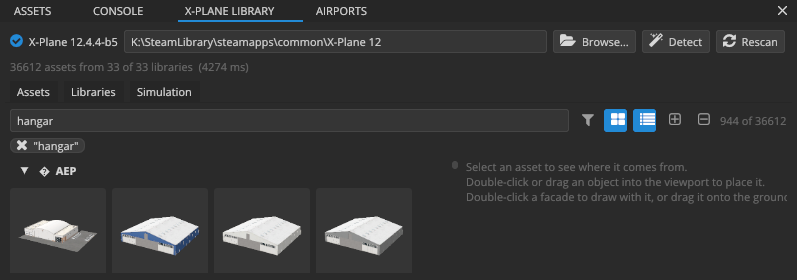

# The X-Plane library

X-Plane's scenery is built from shared art: objects, facades, forests, lines, polygons and more, published under **virtual paths** such as `lib/airport/Ramp_Equipment/Fuel_Truck.obj` by the default libraries and by the libraries you install. The **X-PLANE LIBRARY** panel browses all of it, with previews, and is where you pick what to place.

## How X-Plane libraries work

A **library** is a scenery pack with a `library.txt` file. Each line of `library.txt` *exports* a file under a virtual path. Scenery refers to art by virtual path, not by file, so:

- several libraries can export the same virtual path; X-Plane uses the one with the highest priority (the order of `scenery_packs.ini`), and some exports apply only in a region or season;
- a pack that uses `lib/airport/...` art works on every X-Plane install, whatever the files are called.

Scenery Editor X resolves virtual paths exactly as X-Plane does, and shows you which library each asset really comes from.

## The install bar

The top of the panel shows the X-Plane folder in use, its version, and **Browse…**, **Detect** and **Rescan**. See [Finding X-Plane](first-launch.md#finding-x-plane). A line below it reports the last scan (how many libraries and assets, and how long it took), or *Scanning libraries…* while one runs.

## Browsing assets

The **Assets** tab lists every exported asset.

### Search

Type in the search box to filter by virtual path. Words narrow the search (`airport hangar` finds paths containing both), and a word starting with a minus leaves things out: `hangar -small`.

### Filters

Click the **Filter** button (the funnel) to open the filter drop-down:

- **Asset types:** tick the types to show: Object, Facade, Forest, Line, Polygon, Object String, Autogen Point, Autogen Block, Autogen String, Road Network, Terrain, Beach and Decal. **All**, **None** and **Objects + facades** set several at once.
- **Libraries:** tick the libraries to show (with its own search box). None ticked shows every library.
- **Private and deprecated assets:** libraries can mark assets as private (for their own use) or deprecated (kept for old scenery). They're hidden unless you tick this.
- **Only assets whose files are missing:** find broken exports.
- **Clear all filters.**

The active filters appear as **chips** next to the search box (the types, the library, *Private / deprecated*, *Missing files*, the search text, the saved filter in use). Click a chip to clear that filter.

### Saved filters

The bottom of the filter drop-down, **Saved in the project**, keeps named filters with the open project:

- set the search and filters, type a name and click **Save** (or press <kbd>Enter</kbd>);
- click a saved filter to apply it;
- right-click it to **Rename**, **Update to the current filters** or **Delete**.

Saved filters are stored in the project file (`.edX` and `.sex`), so everyone working on the project gets the same ones, and saving or deleting one can be undone. Without an open project, there's nowhere to save them.

### List and grid

The buttons beside the search box change the view:

- **List** (rows with a small thumbnail) or **thumbnail grid**. In the grid, <kbd>Ctrl</kbd> + mouse wheel changes the tile size.
- **Grouped by library** (a collapsible section per library, with its match count) or **one list**.
- **Open every library** and **Close every library** expand or collapse all the groups.

Libraries and assets that don't match the search and filters are hidden, so a search through tens of thousands of assets leaves only what you're looking for.

### Previews

Every asset gets a preview drawn from the asset itself, in the style WorldEditor uses for each kind:

| Kind | Preview |
|---|---|
| Object (`.obj`) | The object at rest, at its most detailed level |
| Facade (`.fac`) | A 20 m square building with a different wall type on each side, standing on a lawn |
| Forest (`.for`) | A grid of its trees |
| Object string (`.str`) | Its first object |
| Autogen point (`.agp`) | Its tile with its objects |
| Polygon (`.pol`), line (`.lin`) | Flat, one texture repeat; a line shows each of its painted rows |

Previews are drawn in the background and cached in `%LOCALAPPDATA%\SceneryEditorX\cache\thumbnails`. When an asset's file changes, its preview is drawn again. If a preview can't be drawn (a broken file, an unsupported texture), the details pane says why.

## The details pane

Select an asset to see, beside the list:

- a large **preview**;
- the actions for its kind:
  - objects: **Place in scene** (or double-click the asset, or drag it into the viewport);
  - facades: **Draw with it** (arms the facade tool, see [Drawing facades](facades.md)) and **Inspect** (opens it in the FACADES panel);
  - any asset: **Copy path** (the virtual path, for DSF or WED placements) and **Show file** (opens its folder in Explorer);
- **Exported by:** every library that exports this virtual path, with the export kind and any region or season. The one X-Plane will use is marked *Used by X-Plane (highest priority)*. A red mark means the exported file is missing.
- for objects, **Object**: its geometry (triangles, vertices, batches), its textures (albedo, normal map, lit texture), its levels of detail, its animation (groups, hide / show rules, datarefs), lights and manipulators, and any warnings found reading it, plus the **datarefs** its animations use.

## Placing assets

| To place | Do this |
|---|---|
| An object, exactly where you want it | Drag it from the list into the viewport and drop it on the ground. |
| An object, quickly | Double-click it (or **Place in scene**): it's placed at the project's reference point and the camera turns to it. |
| A facade along a footprint you draw | Double-click it (or **Draw with it**), then draw in the viewport. |
| A facade with a default footprint | Drag it onto the ground. |

Objects appear as soon as they've loaded in the background; the status bar shows the progress. Placed objects join the open project and are written to its DSF tiles when you export.

> [!NOTE]
> In this alpha only objects (`.obj`) and facades (`.fac`) can be placed from the library. Forests, lines, polygons, strings and roads already in a project (for example from a WorldEditor import) are drawn and can be edited with the Nodes tool.

## Libraries

The **Libraries** tab lists the scenery packs the editor scanned: X-Plane's own libraries, the packs in `Custom Scenery`, and folders you track.

| Column | Meaning |
|---|---|
| **Library** | The pack's name. Hover for its folder; double-click to browse its assets. |
| **Source** | Where it was found: **Custom Scenery**, **Default Scenery** (X-Plane's own libraries), **Global Scenery**, or a **Tracked Folder**. |
| **In sim** | Whether X-Plane loads it (it's enabled in `scenery_packs.ini`). |
| **Assets** / **Objects** | How many exports, and how many of them are objects. |
| **Missing** | Exports whose files don't exist (with **Check files** on). |
| **Issues** | Problems found reading its `library.txt`. |

- **Track folder…** adds a library folder outside X-Plane, for example a library you're building. Tracked folders are scanned like installed ones. Right-click one to **Stop tracking folder**. **X-Plane › Track Library Folder…** does the same.
- **All packages** also lists scenery packs without a `library.txt`.
- **Check files** verifies that every exported file exists. It finds broken libraries but makes scans slower.
- Right-click a library to **Browse assets** or **Open folder**.

**Rescan** (on the install bar, or **X-Plane › Rescan Libraries**) reads everything again, for example after you install a library while the editor is open.

## Simulation

Animated objects (windsocks, rotating beacons, radar antennas, vehicles) move according to X-Plane **datarefs**. The **Simulation** tab emulates the ones scenery uses:

- the **sim clock**, which you can run or freeze;
- **Night lighting: Force lights on**, to see lit textures, light billboards and light spill in daylight;
- a slider for every dataref the placed objects use, with its current value and range.

The time of day, sun and weather are set in the ENVIRONMENT panel: see [Time, weather and the X-Plane 12 look](environment.md).
