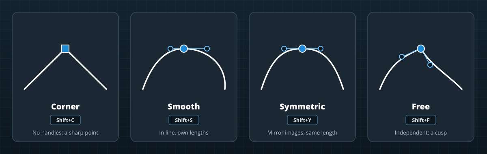

# Editing shapes and paths

Most scenery is made of shapes on the ground: pavement outlines, painted lines, airport boundaries, draped polygons, forests, facade footprints, object strings and roads. In X-Plane they are all chains of **bezier nodes**. The **Nodes** tool (<kbd>V</kbd>) edits them all the same way.

## What the Nodes tool edits

Select one or more shapes, then press <kbd>V</kbd> (or select them with the Nodes tool active). Their nodes and handles appear:

- **Airport elements:** pavement (and its holes), painted lines and light strings, boundaries, and runway ends;
- **Project items:** polygons and orthophotos, lines, object strings, forests, facades, exclusion areas, roads and road junctions.

A node is drawn according to its type, its handles are drawn as lines ending in round grips, and a dashed line shows the control polygon of a B-spline (below).

## Selecting nodes

| To | Do this |
|---|---|
| Select a node | Click it |
| Add a node / toggle one | <kbd>Shift</kbd> + click / <kbd>Ctrl</kbd> + click |
| Select the two nodes of a segment | Click the curve between them |
| Select every node of the shapes being edited | <kbd>Ctrl+A</kbd> |
| Clear the node selection | <kbd>Esc</kbd> |

The **NODES** section of PROPERTIES shows the selected node: its **latitude and longitude**, the **length and heading** of its handles, and its **type**; and for the chain, its **length**, its **tightest bend** (the smallest radius along it), whether it's a **Bezier** or **B-spline**, and whether it's **closed**. Type a value, or drag it, to change it exactly; a drag in PROPERTIES is one undo step.

## Changing a shape

| Edit | How |
|---|---|
| **Move nodes** | Drag a node; every selected node moves with it. A dragged node snaps onto another node when it comes within a few pixels. |
| **Bend a curve** | Drag the curve itself: it bends through the cursor while its ends stay put. |
| **Change a handle** | Drag the grip at the end of a handle. The other handle follows the node's type. Hold <kbd>Shift</kbd> to move one handle on its own. |
| **Insert a node** | Double-click the curve where the node should go. |
| **Delete nodes** | <kbd>Del</kbd>, or the trash button on the viewport toolbar. |
| **Straighten** | <kbd>Shift+L</kbd>: makes the segments between the selected nodes straight. |
| **Extend a line** | With one end of a line selected, <kbd>Ctrl</kbd> + click on the ground past it: a new node is added there. A preview shows where. Drag straight away to pull out its handles. |
| **Close / open a line** | With one end selected, <kbd>Ctrl</kbd> + click the other end to close it; or use the **Close** button on the toolbar. On a closed line, the same button opens it at the selected node. |
| **Reverse** | The **Reverse** button, or **Reverse Direction** in the quad menu: the shape runs the other way. Lines, strings and facades care about direction (which side a line's paint is on, which way facades face). |
| **Move a runway** | Click a runway's edge to select both its ends, then drag. Drag one end to change its heading and length. |

## Node types

A node's type says how its two handles relate. Set it with the buttons on the viewport toolbar or the keys:

| Type | Key | Handles | Use it for |
|---|---|---|---|
| **Corner** | <kbd>Shift+C</kbd> | None: the segments meet in a sharp point | Building corners, pavement edges |
| **Smooth** | <kbd>Shift+S</kbd> | Opposite each other, each with its own length | Curves that change radius smoothly |
| **Symmetric** | <kbd>Shift+Y</kbd> | Mirror images: the same length either side | Even, round curves |
| **Free** | <kbd>Shift+F</kbd> | Independent: a cusp | A curve that turns sharply without stopping |

X-Plane's files only store the handles, not the type, so the editor works out each node's type from its handles when it reads a shape, and remembers your choice when two types would look the same.

> [!TIP]
> To round off a corner, select the corner node and press <kbd>Shift+Y</kbd>: it grows symmetric handles you can then drag to the radius you want.

## B-splines

Bezier handles give full control but make long, flowing curves (a taxiway centerline, a coastline, a road) fiddly: moving one node changes the curve's smoothness at its neighbors. **B-spline** mode edits a chain through a **control polygon** instead.

- Press <kbd>Shift+B</kbd> (or the **B-spline** button) with a chain selected. Its nodes become the control points, connected by a dashed control polygon.
- Drag the control points. The curve always stays smooth (curvature-continuous) and only changes near the points that move.
- Double-click the curve to add a control point.
- Press <kbd>Shift+B</kbd> again to go back to nodes and handles.

The curve is stored as ordinary bezier nodes, so X-Plane, WorldEditor and the file formats see a normal shape, and the editor recognizes a B-spline again when you reopen the project (unless you switched that chain back to bezier).

In PROPERTIES, **B-spline through the nodes** turns a chain into a B-spline that still passes through every existing node. It works best when the nodes are evenly spaced.

## Roads and junctions

Roads run between **junctions** (road nodes). With the Nodes tool:

- selecting a junction lets you move it; every road that starts or ends there follows, keeping its handles, in the same undo step;
- a road's ends can't be deleted or extended where they meet other roads at a shared junction.

See [Road networks](roads.md).

## Working precisely

- A dragged node snaps onto any other node it passes close to, so shapes can share corners exactly.
- Work in a **Top** orthographic view (<kbd>Numpad 7</kbd>, <kbd>Numpad 5</kbd>) to see shapes without perspective.
- For exact positions, type the latitude and longitude in the NODES section; for an exact curve, type the handle length and heading.
- To move whole shapes on a grid, use the **Move** tool (<kbd>W</kbd>) with snapping instead.

Even a polygon with thousands of nodes stays smooth to edit: while you drag, only the shape being edited is rebuilt.
