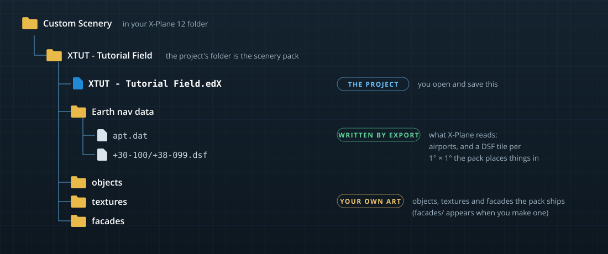

# Projects

A project is the file you work in. It holds everything you author for one scenery pack: its airports, the objects, facades, forests, lines, polygons and roads it places, the library it publishes, and your saved library filters. X-Plane never reads the project itself; you [export](import-export.md#exporting-a-scenery-pack) it to the `apt.dat` and DSF files X-Plane loads.

## Kinds of project

**File › New Project…** (<kbd>Ctrl+N</kbd>) offers three kinds. They differ only in what the dialog asks for and what's in the new folder; any project can have airports added or removed later.

| Kind | For | The dialog asks for | Creates |
|---|---|---|---|
| **Scenery** | Objects, polygons, lines, facades, forests and roads, anywhere in the world. | A name, where to create it, optionally a **reference point** (latitude, longitude, elevation), author and description. | `Earth nav data`, `objects` and `textures` folders and the project file |
| **Airport** | An airport with its ICAO code, ready to lay out. | The airport (ICAO code, name, type, starter layout), its reference point, country, state / county and city, then the pack name, folder and author. | The same folders, with the airport already in the project |
| **Library** | Your own objects, facades and textures for other packs to use through `library.txt`. | A name, folder, author and description (no reference point: a library isn't anywhere). | `objects` and `textures` folders and the project file |

The project's folder is laid out as a scenery pack, so the simplest workflow is to create the project directly in X-Plane's `Custom Scenery` folder (the **Custom Scenery** button next to **Create in**) and export into the same folder. X-Plane then loads the pack straight from where you work.

### The reference point

The **reference point** (also called the datum) is where the project is in the world. The viewport centers on it and new placements start around it. Coordinates are decimal degrees with up to eight decimals, north and east positive: 50°30′ south is `-50.50000000`.

An airport project uses the airport's reference point. A scenery project can leave it out; it then centers on whatever you place or import. Set or change it later in the **PROJECT** section of the PROJECT panel (**Datum**).

> [!NOTE]
> Headings in a project are true headings (relative to true north), as X-Plane expects in DSF and `apt.dat` files. Runway numbers are the exception: they follow magnetic headings, by convention.

## Opening, saving and closing

| Command | Shortcut | Notes |
|---|---|---|
| **File › New Project…** | <kbd>Ctrl+N</kbd> | See above. |
| **File › Open Project…** | <kbd>Ctrl+O</kbd> | Opens `.edX`, `.sex` and WorldEditor `earth.wed.xml` files. Double-clicking a `.edX` or `.sex` file in Explorer does the same. |
| **File › Open Recent** | | The projects you opened last. |
| **File › Save Project** | <kbd>Ctrl+S</kbd> | Saves in the file's own format. The open airport's edits are saved with it. |
| **File › Save Project As…** | <kbd>Ctrl+Shift+S</kbd> | Saves a copy as `.edX`, `.sex` or `earth.wed.xml` and continues with the copy. |
| **File › Close Project** | | Asks first if there are unsaved changes: **Save**, **Don't save** or **Cancel**. |
| **File › Show Project Folder** | | Opens the project's folder in Explorer. |

Only one project is open at a time. Opening another, creating a new one or quitting with unsaved changes asks whether to save first.

The window title shows the project's name, and the PROJECT panel's toolbar has the same New, Save, Save As, Export, Close and Reveal commands.

### Which format to save in

- **`.edX`** is JSON text: readable, and laid out so a change touches as few lines as possible. Use it when the project is in git or any version control: diffs are meaningful, and saving an unchanged project changes nothing on disk. The edit date only moves when the content changed.
- **`.sex`** is a compact binary file with a checksum on every section. It loads and saves faster on very large projects, and detects damage (including line-ending conversion by a careless file transfer) instead of loading garbage.

Both hold exactly the same information, and you can switch at any time with **Save Project As…** or **File › Export › Binary Copy (.sex)…**. [Project file formats](file-formats.md) describes both in detail.

## Recovery and backups

The editor protects your work in three ways, all kept *outside* the project folder (in `%LOCALAPPDATA%\SceneryEditorX\project-cache`), so they never clutter a pack or a git repository:

- **Recovery copies.** Every minute, if the project has unsaved changes, the editor writes them to a recovery file. Saving clears it.
- **Backups.** Each save first copies the previous project file into the cache. The newest five are kept.
- **A snapshot** of the last loaded state, so reopening an unchanged large project is quick. The PROJECT panel notes when a project was opened from it.

### Recovering unsaved work

If the editor closes without saving (a crash, a power cut), the next time you open the project it shows **Recover unsaved work**:

> Unsaved changes to *project* from *time* were found.

- **Restore** replaces what's open with the recovered changes. Nothing is written to the project file until you save, so you can look first.
- **Discard** throws the recovered changes away.
- **Decide later** (or <kbd>Esc</kbd>) leaves them in the cache; you're asked again next time.

If the project file changed after the recovered edits were made (another save, a `git checkout`), the window warns you, because restoring would replace those newer changes.

### Restoring a backup

Backups are complete project files named by date in the project's cache folder (see [Where Scenery Editor X keeps files](file-locations.md#the-project-cache)). To go back to one, copy it out of the cache next to your project and open it.

## The PROJECT panel

The **PROJECT** panel shows the open project in sections.

### PROJECT

The project's details: its kind (**Scenery pack** or **Asset library**), **Author**, **Description**, the **X-Plane** version it targets, the **Pack folder** name it exports to, the **Datum** (reference point) and elevation, and when it was **Created** and last **Edited**.

### AIRPORTS

The airports in the project. A project doesn't need one.

- **New airport** adds a new airport (ICAO code, name, reference point) to the project. **File › New Airport in Project…** does the same.
- **From apt.dat** adds the airports of an existing `apt.dat` file.
- Click an airport to show it in the airport editor (**AIRPORTS › Airport**). Right-click it to **Remove from project**.

Editing airports is covered in [Airports](airports.md).

### HIERARCHY

Every item the project places, as a tree of groups, with the count in the header. Click an item to select it in the viewport (or, for an airport, to show it in the airport editor); hover it to see the art it uses. Right-click an item to:

- **Hide** or **Show** it: hidden items stay in the project, greyed out and marked *(hidden)*, but aren't drawn or exported;
- **Lock** or **Unlock** it: locked items can't be moved or edited;
- **Remove from project**.

Item kinds are: groups, objects, polygons and orthophotos (draped `.pol`), lines (`.lin`), object strings (`.str`), forests (`.for`), facades (`.fac`), autogen, exclusion zones and polygons, road nodes and roads (`.net`), and any WorldEditor objects the editor keeps verbatim so they survive a round trip.

Objects you place from the X-PLANE LIBRARY join the project automatically.

### LIBRARIES

Which X-Plane libraries the project's art comes from. **Find Used Libraries** records the library each placed asset comes from, so people who download your pack know what to install.

### LIBRARY

In a library project (or any project that publishes art), the `library.txt` the project authors: its exports, each mapping a **virtual path** (the name other packs use) to a file in the project folder.

- **Add Files…** exports art files from the project folder (`.obj`, `.fac`, `.for`, `.lin`, `.pol`, `.str`, `.agp`, `.agb`, `.ags`, `.net`, `.ter`, `.bch`, `.dcl`).
- **Add Export** adds an export row by hand. Each row has a kind (`EXPORT`, `EXPORT_EXTEND`, `EXPORT_EXCLUDE`, `EXPORT_BACKUP`, or `EXPORT_RATIO` with its ratio), the virtual path, the real path and an optional region.
- **Export library.txt…** writes it.

### VALIDATION

Problems X-Plane may reject, found as you edit: a missing asset, an unclosed ring, a road end that isn't on its junction, an airport row out of range. The header counts them, and *No problems found* means the pack should load cleanly. The same list appears in the Export dialog.

## Library filters in the project

Named filters you save in the X-PLANE LIBRARY's **Filter** drop-down are stored in the project (in both `.edX` and `.sex`), so everyone who works on the project gets the same filters. See [Saved filters](library.md#saved-filters).
