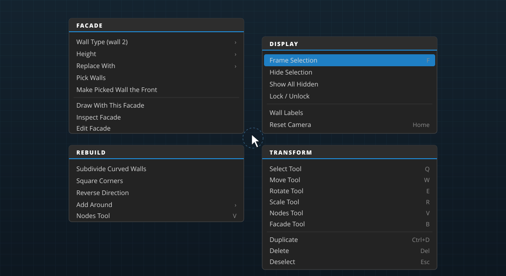

# Selecting, transforming and undo

Everything you change in the viewport starts with a selection. This chapter covers picking things, the move, rotate and scale tools, the settings in PROPERTIES, the commands that act on a selection, the two context menus (the quad menu and the hotbox), and undo.

## What you can select

Clicking in the viewport picks exactly what's under the cursor, pixel for pixel, even in a scene with tens of thousands of objects. What you pick is one of three kinds of thing:

- **Airport elements:** runways, helipads, pavement, painted lines and light strings, boundaries, signs, windsocks, the beacon, startup locations and the other rows of the open airport's `apt.dat`.
- **Project items:** what your project places in DSF scenery: objects, facades, forests, lines, polygons, strings, roads and road junctions.
- **Scene entities:** objects placed straight into the scene (for example with **X-Plane › Import Object (.obj)…**) and anything added from the OUTLINER.

The selection is remembered by *what* it is, not where it's drawn, so it survives the scene being rebuilt after an edit.

## The Select tool

Press <kbd>Q</kbd> for the **Select** tool.

| To | Do this |
|---|---|
| Select one thing | Click it. Hovering shows what a click would pick. |
| Add to the selection | <kbd>Shift</kbd> + click |
| Toggle one thing in or out | <kbd>Ctrl</kbd> + click |
| Select everything in a rectangle | Drag a box on empty space (add <kbd>Shift</kbd> or <kbd>Ctrl</kbd> as above) |
| Clear the selection | <kbd>Esc</kbd>, or click empty ground |

The selection is outlined in the viewport, and the last thing you clicked is the **active** one: PROPERTIES shows it, and it's the pivot when the pivot is set to the active object.

All the other tools select the same way when you click something that isn't part of the tool's own handles.

## Moving, rotating and scaling

<!-- class: shortcuts -->
| Tool | Key | What it does |
|---|---|---|
| **Move** | <kbd>W</kbd> | Drag the gizmo's arrows to move along one axis, or its planes to move on two. Things on the ground stay on the ground. |
| **Rotate** | <kbd>E</kbd> | X-Plane objects, facades and other items have only a heading, so they turn about the vertical. Scene entities turn about any axis. |
| **Scale** | <kbd>R</kbd> | Shapes on the ground (polygons, facades, lines) scale across the ground; scene entities scale on any axis. |

Hold <kbd>Ctrl</kbd> while dragging to snap. The tool options at the left of the viewport toolbar control how the gizmo behaves:

- **Snapping** (the magnet): when it's on, every drag snaps and <kbd>Ctrl</kbd> turns snapping *off* for that drag. Right-click the magnet to set the steps: **Move** in meters, **Rotate** in degrees, and **Scale**.
- **Gizmo axes** (<kbd>X</kbd>): **local** axes follow the active object's heading; **world** axes follow north and east.
- **Pivot:** turn and scale about the **active object** or about the **selection's center**.

To type exact values, use **PROPERTIES** (below).

## The PROPERTIES panel

**PROPERTIES** shows the settings of the active selection, in collapsible sections. What you see depends on what's selected:

| Selected | Sections |
|---|---|
| An airport element | **AIRPORT:** the element's own fields. A runway has its surface, edge lights and, per end, its number, markings, approach lights and REIL; a sign its text and size; a startup location its type, aircraft size, operations and airlines; pavement its surface and layer; and so on. |
| An object or entity | **GENERAL PROPERTIES** (name, ID), **TRANSFORM** (position, rotation, scale), **X-PLANE OBJECT** (file, library path, geometry and light counts, visibility, animation and LOD), and its components. |
| A facade | **FACADE:** the facade, its height and wall types, and the facade tool's settings. See [Drawing facades](facades.md). |
| Nodes in the Nodes tool | **NODES:** the selected node's latitude and longitude, handle length and heading, node type, the chain's length and tightest bend. See [Editing shapes and paths](node-editing.md). |

A field commits when you press <kbd>Enter</kbd> or leave it, and every commit is one undo step. Changing geometry (a runway surface, a line type) rebuilds just that element, so even a large airport stays responsive.

## Commands for the selection

| Command | Shortcut | Where | What it does |
|---|---|---|---|
| **Delete** | <kbd>Del</kbd> | Edit menu, quad menu | Removes the selection. With the Nodes tool, deletes the selected nodes instead. |
| **Duplicate** | <kbd>Ctrl+D</kbd> | Edit menu, quad menu | Copies the selected project items, 3 m to the south-east, and selects the copies. |
| **Deselect** | <kbd>Esc</kbd> | Edit menu, quad menu | Clears the selection (or cancels the drawing in progress). |
| **Frame Selection** | <kbd>F</kbd> (<kbd>Z</kbd> in 3ds Max), <kbd>Numpad .</kbd> | Edit menu, quad menu | Turns the camera to the selection and makes it the pivot. |
| **Hide Selection** | | Edit menu, quad menu | Hidden items stay in the project but aren't drawn or exported. |
| **Show All Hidden** | | Edit menu, quad menu | Shows every hidden project item again. |
| **Lock / Unlock** | | Edit menu, quad menu | Locked items can't be moved or edited until you unlock them. |
| **Reverse Direction** | | quad menu, Nodes toolbar | Lines, strings and facades run (and face) the other way. |

Hiding and locking are also in the right-click menu of each item in the PROJECT panel's hierarchy.

## The quad menu

Right-click in the viewport (a quick click, without dragging) to open the **quad menu**, a menu in four parts around the cursor, inspired by 3ds Max. It picks what's under the cursor first, so the menu is about the thing you clicked.

- **Top right, DISPLAY:** frame, hide, show all, lock, wall labels, reset camera.
- **Bottom right, TRANSFORM:** the tools, duplicate, delete, deselect.
- **Top left:** what you clicked.
  - a facade: **FACADE**: wall type (for the picked walls), height, replace with another facade, pick walls, make the picked wall the front, draw with this facade, inspect, edit in the facade editor;
  - another project item: its kind, with the Nodes tool, reverse, duplicate and hide;
  - an airport element: **AIRPORT**: what it is, the Nodes tool, reverse and frame;
  - empty ground: **CREATE**: draw a facade as a rectangle, polygon, circle or line, place the armed facade right here, and the facade library.
- **Bottom left:** for a facade, **REBUILD** (subdivide curved walls, square corners, reverse, add a facade around it); for empty ground, **EDIT** (undo, redo, save); otherwise **CREATE**.

Click an entry to run it; <kbd>Esc</kbd> or a click outside closes the menu. A right-*drag* still looks around, so the quad menu never gets in the way of navigating.

## The hotbox

Hold <kbd>Space</kbd> with the mouse over the viewport to open the **hotbox**, inspired by Maya. The editor dims and three rows of menus open around the cursor:

1. **The menu bar's menus:** File, Edit, Scene, X-Plane, Facade, Window, Viewport, Help.
2. **Recent Commands** (the last commands you ran from any menu) and **Facades** (the facade library and your recent facades).
3. **The selection's menus:** the same parts as the quad menu.

Pick a command while holding <kbd>Space</kbd>; release <kbd>Space</kbd> to close the hotbox. With a big screen and the menu bar far away, the hotbox puts every command a few centimeters from the mouse.

## Undo and redo

Every edit (a drag, a field change, a node edit, a facade drawn, an item deleted) is one step in the history.

- <kbd>Ctrl+Z</kbd> undoes; <kbd>Ctrl+Y</kbd> or <kbd>Ctrl+Shift+Z</kbd> redoes.
- **Edit › Undo** and **Edit › Redo** name the step they'll undo or redo.
- The history keeps the last 256 steps (fewer if very large airport edits fill its memory budget).

Undo works across panels: undoing a runway change made in PROPERTIES works the same as undoing a drag in the viewport. The FACADE EDITOR has its own history while it has focus (see [Making your own facades](facade-editor.md)).

> [!TIP]
> Undo is about the session. Saving doesn't clear it, so you can save, try something, and still undo back past the save.
