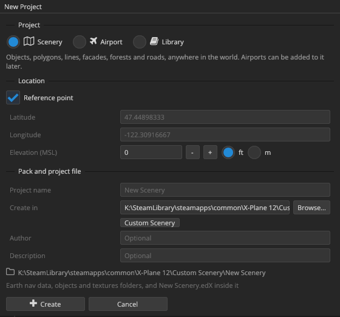
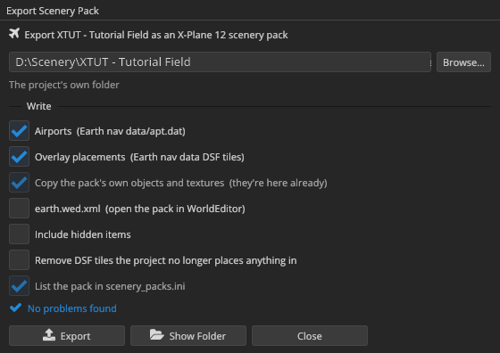

# Tutorial: your first airport

In this tutorial you build a small airfield from nothing and fly it in X-Plane 12. On the way you meet the parts of the editor you'll use every day: the New Project dialog, the viewport, the PROPERTIES panel, the X-PLANE LIBRARY, the move and node tools, the facade tool, saving and exporting. It takes about twenty minutes.

You need Scenery Editor X installed, X-Plane 12 found by the editor (see [Finding X-Plane](first-launch.md#finding-x-plane)), and the default libraries that come with X-Plane.

")

## 1. Create the project

A project is the file you work in; the scenery pack is what X-Plane loads. A new airport project creates both at once, in the same folder.

<!-- class: steps -->
1. Choose **File › New Project…** or press <kbd>Ctrl+N</kbd>.
2. Under **Project**, choose **Airport**.
3. Fill in the **Airport** section:
   - **ICAO code:** `XTUT`. Airport identifiers must be unique across X-Plane; codes starting with X aren't used by real airports, so they're safe for practice.
   - **Airport name:** `Tutorial Field`
   - **Type:** Airport
   - **Starter layout:** leave it ticked. You get a runway, a windsock and a beacon to start shaping, because X-Plane needs at least one runway.
4. Fill in the **Reference point**: the point the airport is built around. For this tutorial use flat Kansas farmland: **Latitude** `38.50000000`, **Longitude** `-98.50000000`, **Elevation** `1850` ft. North and east are positive; south and west are negative.
5. Under **Region**, set **Country** (required) to `USA United States`. State and city are optional.
6. Under **Pack**, click **Custom Scenery** next to **Create in**. The pack is created right where X-Plane will load it from. Leave **Project name** empty to use `XTUT - Tutorial Field`.
7. Click **Create**.

The editor creates `Custom Scenery/XTUT - Tutorial Field/` with an `Earth nav data` folder, `objects` and `textures` folders and the project file `XTUT - Tutorial Field.edX`, then opens the project and frames the new airport in the viewport.

> [!TIP]
> If a field is wrong, the dialog says which one under the field and counts the problems next to the buttons. Nothing is created until every field is valid.

## 2. Look around

The new airport has a 1000 m north–south asphalt runway through the reference point, numbered 18 and 36, with a lit windsock beside it and a beacon.

Try these, with the mouse over the viewport:

- **Orbit, pan and zoom** with the keymap you picked on the first launch. In the Blender keymap: middle-drag orbits, <kbd>Shift</kbd> + middle-drag pans, the wheel zooms.
- Press <kbd>Numpad 7</kbd> for a view straight down, and <kbd>Numpad 5</kbd> to switch between perspective and orthographic. Orthographic is good for lining things up.
- Press <kbd>Home</kbd> to frame the whole airport again.
- Hold the right mouse button and press <kbd>W</kbd> <kbd>A</kbd> <kbd>S</kbd> <kbd>D</kbd> to fly around at ground level.

[Navigating the viewport](viewport-navigation.md) lists every control.

## 3. Shape the runway

<!-- class: steps -->
1. Press <kbd>Q</kbd> for the **Select** tool and click the runway. It is outlined, and the **PROPERTIES** panel shows its settings.
2. Change **Surface** to **Concrete**, and **Edge lights** to **Medium intensity**.
3. Under **End 1** and **End 2**, set **Markings** to **Non-precision**. The runway markings in the viewport update as you change them.
4. Now turn the runway. Press <kbd>V</kbd> for the **Nodes** tool: grips appear at the runway's two ends. Drag the north end about 170 m to the west. The south end stays put, so the runway turns about it, by about 10°.
5. A runway's number is the heading you land on, divided by ten and rounded. Landing toward the north end now means flying a heading of about 350°, so rename the south end (**End 2**) **35** and the north end (**End 1**) **17** in PROPERTIES. (Real runway numbers follow the magnetic heading; for practice, the true heading is close enough.)
6. The beacon stood west of the old runway, so the turned runway now runs over it. Click the beacon, press <kbd>W</kbd> for the **Move** tool, and drag it about 100 m further west.

Every change is one step in the undo history. Press <kbd>Ctrl+Z</kbd> to undo and <kbd>Ctrl+Y</kbd> to redo; **Edit › Undo** names the step it will undo.

## 4. Place a hangar

Objects come from the X-Plane library: the thousands of assets X-Plane and your installed libraries share by name.

<!-- class: steps -->
1. Open the **X-PLANE LIBRARY** panel and its **Assets** tab.
2. Type `hangar` in the search box. To see only objects, open the **Filter** drop-down (the funnel), click **None** under **Asset types** and tick **Object**.
3. Click an asset to see its preview and where it comes from. Pick one you like; anything under `lib/airport/` is a good start.
4. **Drag** the asset from the list into the viewport, and drop it beside the runway. It appears as soon as it has loaded in the background.
5. With the hangar selected, press <kbd>W</kbd> for the **Move** tool and drag the gizmo's arrows to place it exactly. Objects on the ground stay on the ground.
6. Press <kbd>E</kbd> for **Rotate** and turn it to face the runway. X-Plane objects only have a heading, so they turn about the vertical. Hold <kbd>Ctrl</kbd> to snap.

> [!TIP]
> Double-clicking an object in the library places it at the project's reference point and turns the camera to it. Dragging puts it exactly where you drop it.

Place two or three more objects the same way: a fuel truck, a small terminal, some parked aircraft.

## 5. Fence the apron with a facade

Facades are buildings, fences and walls generated along a footprint you draw. Here you'll draw a fence.

<!-- class: steps -->
1. In the X-PLANE LIBRARY, search for `fence` and tick only the **Facade** type in the Filter drop-down.
2. Double-click a fence facade. This *arms* it in the **Facade** tool and switches to that tool (<kbd>B</kbd>). The viewport toolbar now shows the facade's name, the drawing modes and its height.
3. Press <kbd>4</kbd> for **Line** mode: an open run of walls, which is what a fence is.
4. Click in the viewport to place the fence's first post, then click again for each corner around the hangars.
5. Double-click, press <kbd>Enter</kbd> or right-click to finish. <kbd>Backspace</kbd> takes back the last corner while you draw, <kbd>Esc</kbd> cancels, and holding <kbd>Shift</kbd> keeps walls at 45° steps.

Want a building instead? Arm a building facade and press <kbd>2</kbd> for **Rectangle** mode: click the two ends of the front wall, then click again to set the depth. [Drawing facades](facades.md) covers wall types, heights and the rest.

## 6. Save

Press <kbd>Ctrl+S</kbd>. The project saves to `XTUT - Tutorial Field.edX`, airport edits included.

Even before you save, the editor keeps a recovery copy of unsaved work: if it ever closes unexpectedly, it offers to recover your changes the next time you open the project. See [Projects](projects.md#recovery-and-backups).

## 7. Export the scenery pack

X-Plane doesn't read projects; it reads `apt.dat` and DSF files. Exporting writes them.

<!-- class: steps -->
1. Choose **File › Export Scenery Pack…** or press <kbd>Ctrl+E</kbd>.
2. The folder is already the project's own folder, and the dialog confirms *The project's own folder, in Custom Scenery: X-Plane loads it from here*.
3. Leave **Airports** and **Overlay placements** ticked. Tick **List the pack in scenery_packs.ini** so X-Plane gives it top priority.
4. Check the line under the options. *No problems found* means X-Plane should accept the pack; otherwise open the list and fix what it names.
5. Click **Export**. The dialog reports what it wrote: one airport, the DSF tiles with your objects and facades, and the files written.

Next time, <kbd>Ctrl+Shift+E</kbd> (**File › Export Again**) exports with the same settings without opening the dialog.

## 8. Fly it

<!-- class: steps -->
1. Start X-Plane 12.
2. In **New Flight**, search for `XTUT` and choose a runway.
3. Look around: your runway, hangar, objects and fence are there.

If the airport doesn't appear, see [My exported airport doesn't show up in X-Plane](troubleshooting.md#my-exported-airport-doesnt-show-up-in-x-plane).

## What you learned

- **File › New Project…** creates a project and its scenery pack together.
- The **Select**, **Move**, **Rotate** and **Nodes** tools (<kbd>Q</kbd> <kbd>W</kbd> <kbd>E</kbd> <kbd>V</kbd>) select and change what's in the scene, and **PROPERTIES** edits the selection's settings.
- The **X-PLANE LIBRARY** is where objects and facades come from: drag objects in, double-click facades to draw with them.
- <kbd>Ctrl+S</kbd> saves the project; <kbd>Ctrl+E</kbd> exports what X-Plane reads.

From here, [A tour of the interface](interface.md) explains the rest of the workspace, and Part III goes deeper into each kind of scenery.
