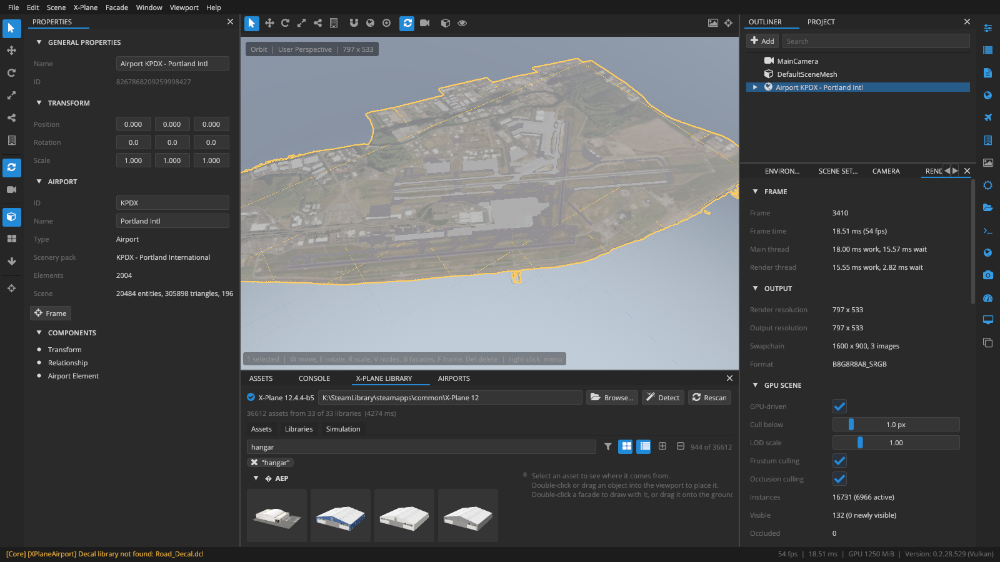

# Welcome to Scenery Editor X

Scenery Editor X is a free, open-source editor for building X-Plane 12 scenery in a real-time 3D viewport. You lay out airports, place library objects, draw facades and shape lines and polygons while you look at them lit, shadowed and textured the way X-Plane 12 draws them, then export a scenery pack you can fly the same afternoon.

## What you can do with it

Scenery Editor X is built for scenery developers: people who make airports, cities and asset libraries for X-Plane. Today it lets you:

<!-- class: cards -->
- **Work in projects.** A project holds everything you author for one scenery pack. It saves as readable JSON (`.edX`) that works well in git, or as a compact binary (`.sex`), and survives crashes through an automatic recovery copy.
- **Open any airport.** Every `apt.dat` in your X-Plane install is indexed in about a second. Open one, edit runways, pavement, lines, signs and startup locations, and save it into your own pack.
- **Pull from the Scenery Gateway.** Search the X-Plane Scenery Gateway, download the recommended submission for an airport and open it as a pack.
- **Browse the X-Plane library.** Every library asset in your install and your tracked folders, with preview thumbnails, search, filters and filters saved in the project.
- **Place and edit.** Place objects and facades, move and rotate them with gizmos, edit bezier nodes of pavement, lines, boundaries, facades and roads, with undo for every step.
- **Draw and author facades.** Draw facades with any library `.fac`, pick wall types per wall, and make your own facades: buildings from a texture, sidewalks and curbs from a cross-section.
- **See it as X-Plane does.** The viewport emulates X-Plane 12's lighting: sun and moon for any date and place, atmosphere, exposure, cascaded shadows and ambient occlusion, with weather and wet runways.
- **Export a pack.** One command writes `apt.dat`, DSF tiles and the pack's own art into a folder X-Plane loads, and can list it in `scenery_packs.ini` for you.
- **Bring WorldEditor projects along.** Open an `earth.wed.xml` from WorldEditor (WED), keep working on it, and write it back out for WED if you need to.

## How it relates to WorldEditor

Laminar Research's WorldEditor (WED) is the reference tool for X-Plane airports, and the Scenery Gateway expects what WED produces. Scenery Editor X reads and writes the same files (`apt.dat` 12.00, DSF, `earth.wed.xml`) and follows WED's conventions for wall choice, bezier handles, DSF layout and asset previews, so a pack can move between the two.

What Scenery Editor X adds is the 3D viewport and the tools that come with it: you edit in the world you will fly in, with tools that behave like the 3D packages many scenery artists already use. If you know Blender, 3ds Max or Maya, you can pick that program's mouse controls on the first launch.

## Who this manual is for

This manual is written for scenery authors. You don't need to be a programmer. It helps to know your way around an X-Plane install (the `Custom Scenery` folder, what a scenery pack is), but every X-Plane term used here is explained in the [Glossary](glossary.md).

If you want to build the editor from source or help develop it, see [Building from source](building-from-source.md).

## How this manual is organized

| Part | What's in it |
|---|---|
| **I · Getting Started** | Installing, the first launch, and [a tutorial](tutorial-first-airport.md) that takes a new airport from an empty folder to X-Plane. Start here. |
| **II · The Workspace** | The [interface](interface.md), [moving around the viewport](viewport-navigation.md), and [selecting and editing](selecting-and-editing.md). |
| **III · Building Scenery** | One chapter per kind of work: projects, airports, the library, shapes and paths, facades, roads, the environment, importing and exporting. |
| **IV · Reference** | [Shortcuts](shortcuts.md), [menus](menus.md), [panels](panels.md), [command-line options](command-line.md), file formats and locations, [troubleshooting](troubleshooting.md) and the [glossary](glossary.md). |

### Conventions

- Menu commands are written as a path: **File › New Project…** means open the **File** menu and choose **New Project…**.
- Keys and shortcuts look like <kbd>Ctrl+S</kbd>. On a keyboard without a numeric keypad, the numpad views are also in the **Viewport** menu.
- Panel names are written in capitals, the way the editor shows them: the **PROPERTIES** panel, the **X-PLANE LIBRARY** panel.
- Paths such as `Custom Scenery/My Airport/Earth nav data/apt.dat` use forward slashes. On Windows they are the same folders with backslashes.

> [!NOTE]
> Scenery Editor X is alpha software and changes quickly between test builds. This edition describes version 0.2.28. If something on your screen doesn't match the manual, the editor has probably moved on: please [open an issue](https://github.com/Coalition-of-Freeware-Developers/Scenery-Editor-X/issues) so the manual can catch up.

## What isn't there yet

So that nothing in this manual surprises you, here is what the current alpha does **not** do. These are planned, not missing by accident:

- **Drawing new airport surfaces.** A new airport starts with a runway, a windsock and a beacon, and you can edit every element an airport already has, but there are no tools yet to draw new taxiways, pavement areas or runways from scratch. Import them from a WorldEditor project, or start from an existing airport.
- **Autogen and terrain.** `.ags` / `.agb` autogen isn't drawn, and scenery sits on a flat ground plane rather than on X-Plane's terrain mesh.
- **Importing 3D models** other than X-Plane `.obj`, and the plugin system mentioned in the project's README.
- **macOS and Linux builds.** The code is cross-platform and its file handling already works on all three systems, but test builds are Windows only for now.
